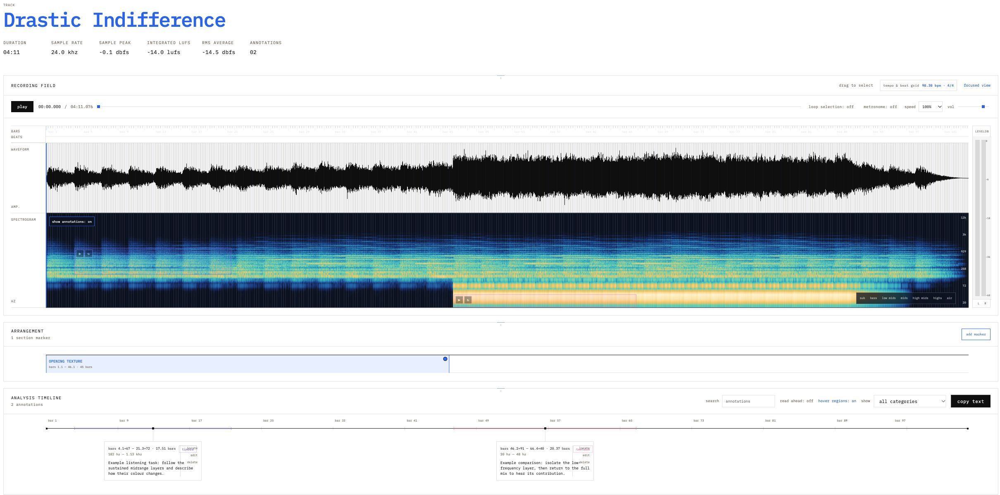
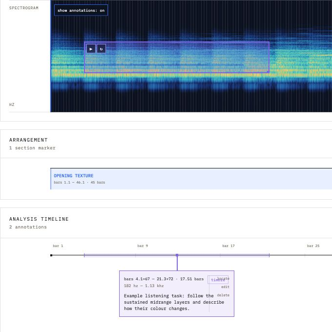

# Music Analyser

**A spectrogram annotation platform for close listening, music education and precise feedback on recordings.**

Music Analyser is an ongoing project by Pat Carroll investigating how a shared visual representation of a recording can support musical analysis and communication. It connects written observations to specific moments and frequency regions, allowing a listener to move between what they hear, what they see and what they want to describe.

[Project discussion](https://pcarroll.au/tools/music-analyser/) · [Current capabilities](#current-capabilities) · [Installation](#installation)

## Project context

The starting point is a problem I have encountered in teaching: students need a practical space in which to listen closely, organise observations and relate those observations to the musical work. A timestamp can locate a passage, but it does not necessarily identify the sound within it that deserves attention.

This project brings listening, spectrograms and annotation into one workspace. Students can mark a passage, focus on a frequency range, replay it and write a detailed observation. An arrangement map sits alongside the notes, making it possible to consider the structure of the composition as well as individual events.

The same approach has a second application in feedback between artists, engineers, collaborators, labels and A&R teams. A note about a particular sound can be attached directly to the relevant time-and-frequency region. The recipient has a more precise reference for the discussion and can audition that region within the recording.

These are the questions guiding development. The current application is a working desktop prototype, version **0.2.3**, and a first step towards evaluating these uses. It does not yet establish improved learning or communication outcomes. Classroom use, feedback practices and the interpretation of visual information are areas for further investigation.



*Bounty Hill's “Drastic Indifference”, from Fourth Cause, with illustrative listening tasks. The recording is not included in this repository.*

## Current capabilities

| Area | What the current app supports |
| --- | --- |
| Visual listening | Aligned waveform and logarithmic spectrogram, drawn from a local audio file. |
| Precise annotation | Time ranges on the waveform; time-and-frequency boxes on the spectrogram; several linked regions for one note. |
| Structured notes | Built-in form, melody, rhythm, harmony, timbre, texture and dynamics categories, plus custom categories and colour-coded cards. |
| Region audition | Play or loop saved regions. Spectrogram selections use steep high-pass and low-pass filters to focus listening on the selected band. |
| Listening controls | Sub-to-air frequency presets, pitch-preserving playback at 50%, 75%, 100% and 125%, selection looping and a stereo level meter. |
| Musical time | Estimated BPM, beat phase and downbeat, with confidence indicators, manual grid correction and an optional accented metronome. |
| Arrangement | Named and coloured section markers, with boundaries snapped to bar starts. Detailed annotations keep their exact selected seconds. |
| Reviewing | Search, category filters, optional read-ahead notes, focused view and undo/redo. |
| Saving and exchange | Local autosave, recent recordings, editable JSON session import/export and categorised plain-text copying. A session can include a sender-provided HTTPS audio-download link. |
| Measurements | Integrated LUFS, sample peak and whole-track RMS. Sample peak is not a true-peak measurement. |



*A note retains its time and frequency reference. Region playback filters the mix; it does not separate an instrument or produce a stem.*

## Installation

The desktop build is currently verified on **Apple Silicon macOS**. Windows, Linux and Intel Mac packages have not been verified. This publication contains source and screenshots; it does not provide a signed installer or hosted app.

Install [Node.js](https://nodejs.org/) with npm. Use Node.js 22.12 or later; verification used Node.js 26.13.0 and npm 11.20.0.

```bash
git clone https://github.com/pmancaz/music-analyser.git
cd music-analyser
npm ci
npm start
```

`npm ci` downloads the locked Electron runtime and build tools. There are no model weights, API keys or accounts to configure.

To make a local unsigned macOS app, DMG and zip:

```bash
CSC_IDENTITY_AUTO_DISCOVERY=false npm run build
```

On Apple Silicon, the app is written to `dist/mac-arm64/Music Analyser.app`. Unsigned builds are for local development and have not been notarised for distribution.

## Basic workflow

1. Choose or drop a recording. WAV is a useful starting point; support for other formats depends on Chromium's decoder.
2. Check the tempo and beat grid if you want to work in bars. Correct its estimate where necessary.
3. Drag across the waveform, or draw a box on the spectrogram. Choose a category and add an observation.
4. Select a saved note to reveal its region. Use that region's play or loop control to listen again.
5. Map arrangement sections separately from the analytical notes. Use search and category filters to review the analysis.
6. Save an editable JSON session, or copy the analysis as text. Keep the recording and session backed up separately.

For exchange, send the JSON and arrange access to the same recording. The JSON does not contain audio. An optional download link helps the recipient obtain it; they still select the downloaded file themselves. The current workflow has no live co-editing, threaded discussion, shared accounts or automatic cloud sync.

## Data and limitations

Audio analysis and playback run locally. The app requests IBM Plex Mono from Google Fonts when online. A sharing action uses the destination you choose, and opening an optional audio link contacts its host. See [Privacy](PRIVACY.md) for the full description.

Notes are held in local application storage. Clearing it removes saved analysis data; moving a recording can break its recent-file shortcut. Export JSON sessions for portable backups.

Tempo estimation assumes a constant grid and can be ambiguous around pickups, ambient introductions, syncopation and changing tempo. The spectrogram analyses the first channel with a fixed 2048-point FFT. There is no zoomed editing view yet, so very short events in long recordings can be difficult to select. The displayed sample rate belongs to the decoded analysis buffer and may differ from the source file's rate. Filtering helps direct attention but cannot isolate sources that overlap in frequency.

The dependency installation on 17 November 2026 reported **13 npm audit findings: 6 moderate and 7 high**, including Electron and transitive build dependencies. These remain unresolved in the published lockfile; the passing tests and build are not a security assessment.

## Verification and development

```bash
npm test
npm run sync:legal
```

All **30 generated-audio tests** and the unsigned Apple Silicon macOS build passed on 17 November 2026. Tests cover loudness calibration and gating, tempo/downbeat estimates, spectrogram sizing and frequency mapping, and metronome scheduling calculations. They do not establish performance on all music, classroom effectiveness or perceptual timing in every playback environment.

For a browser-based development check, serve this directory with `python3 -m http.server 4173` and open `http://127.0.0.1:4173`. Adding `?demo=1` generates a synthetic test recording. Native metadata and recent-file reopening require Electron.

See [Project Overview](project-overview.md) for source orientation and implementation details.

## Acknowledgements and rights

The interface and analysis are implemented in HTML, CSS and JavaScript, using the Web Audio and Canvas APIs. The desktop shell uses [Electron](https://github.com/electron/electron/blob/main/LICENSE), and packaging uses [electron-builder](https://github.com/electron-userland/electron-builder/blob/master/LICENSE); both use the MIT licence and retain their upstream dependency notices. [IBM Plex Mono](https://github.com/IBM/plex/blob/master/LICENSE.txt) uses the SIL Open Font License 1.1 and is requested through Google Fonts rather than bundled here. No machine-learning model is used.

The loudness implementation follows ITU-R BS.1770-5, with generated calibration checks based on EBU Tech 3341 cases. This is not a claim of standards certification.

© 2026 Pat Carroll. **All rights reserved.** The existing [Terms of Use](TERMS.md) remain in effect. Public access to this repository does not grant an open-source licence to the application. Third-party components retain their own licences. The screenshot recording is a separate creative work and is not supplied as a reusable asset.
