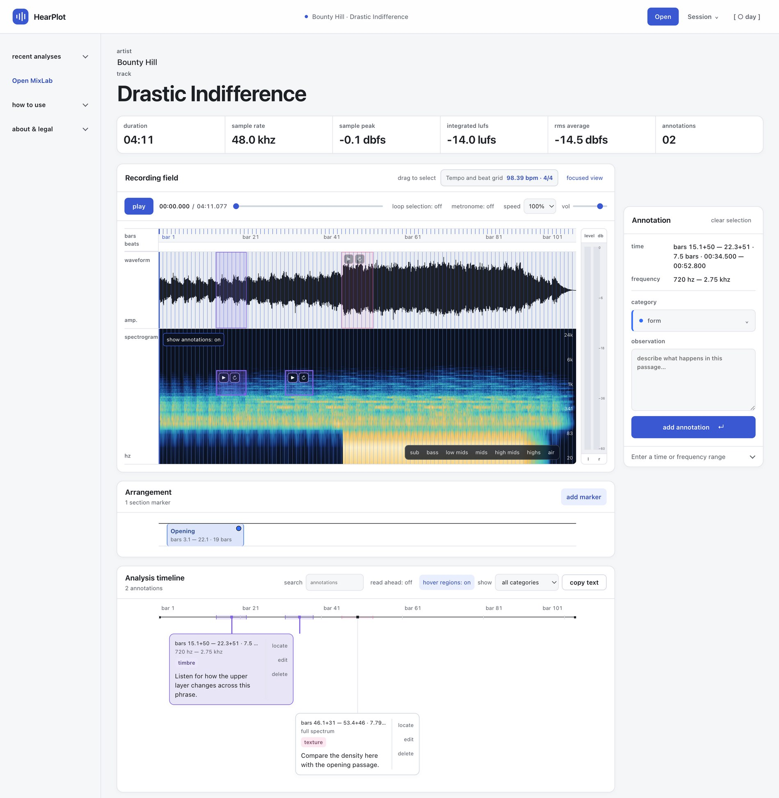
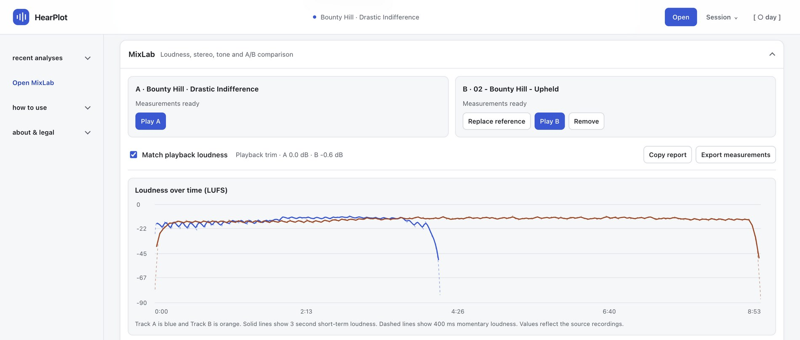

# HearPlot

**A spectrogram annotation platform for close listening, music education and precise feedback on recordings.**

**[Download HearPlot for Mac (.dmg)](https://github.com/pmancaz/music-analyser/releases/download/v0.3.0/HearPlot-0.3.0-Apple-Silicon.dmg)**

For **Apple silicon Macs (M-series), macOS 12 or later**. Open the disk image and drag HearPlot into Applications. [Release notes](https://github.com/pmancaz/music-analyser/releases/tag/v0.3.0)

HearPlot is an ongoing project by Pat Carroll investigating how a shared visual representation of a recording can support musical analysis and communication. It connects written observations to specific moments and frequency regions, allowing a listener to move between what they hear, what they see and what they want to describe.

[Project discussion](https://pcarroll.au/tools/music-analyser/) · [Current capabilities](#current-capabilities) · [Installation](#installation)

## Project context

The starting point is a problem I have encountered in teaching: students need a practical space in which to listen closely, organise observations and relate those observations to the musical work. A timestamp can locate a passage. Selecting a frequency range helps direct attention to a particular sound within it.

This project brings listening, spectrograms and annotation into one workspace. Students can mark a passage, focus on a frequency range, replay it and write a detailed observation. An arrangement map sits alongside the notes, making it possible to consider the structure of the composition as well as individual events.

The same approach has a second application in feedback between artists, engineers, collaborators, labels and A&R teams. A note about a particular sound can be attached directly to the relevant time-and-frequency region. The recipient has a more precise reference for the discussion and can audition that region within the recording.

These are the questions guiding development. Version **0.3.0** brings these workflows into a redesigned workspace and adds MixLab for more detailed listening and comparison. How students use frequency-focused playback, and whether precise references change the quality of feedback, remain questions for evaluation.



*Bounty Hill's “Drastic Indifference”, from Fourth Cause, with illustrative listening tasks. The recording is not included in this repository.*

## Related work and design problem

When someone writes about a dense recording, marking the time gets the next listener to the right passage. They may still have to work out which sound within it the note refers to. I wanted a single workflow for finding that sound, focusing the ear on it, describing it in musical terms and passing the observation on.

[SoundCloud](https://help.soundcloud.com/hc/en-us/articles/115003566008-Comments) anchors comments to points on a waveform. [Notetracks](https://www.notetracks.com/blog/how-to-comment-on-any-audio-file) provides time-range feedback and text reports, and [Boombox](https://help.boombox.io/en/articles/9718329-time-ranged-comments) supports text and voice notes over a passage. [Sonic Visualiser](https://sonicvisualiser.org/doc/reference/5.2.1/en/#boxes) stores labelled time–frequency boxes in an annotation layer. [EAnalysis](https://logiciels.pierrecouprie.fr/?page_id=402) uses custom analytical parameters and can compute filtered tracks from graphical annotations. [Audacity](https://manual.audacityteam.org/man/importing_and_exporting_labels.html), [Acousmographe](https://inagrm.com/fr/showcase/news/203), [Raven Pro](https://www.ravensoundsoftware.com/software/raven-pro/) and [NEAL](https://arxiv.org/abs/2212.01457) provide further precedents for spectral labels, listening guides and structured annotation. [Detailed comparisons and sources](docs/related-work.md)

HearPlot puts the **observation** at the centre of the workflow. Draw a time–frequency region on the spectrogram, play or loop that band, choose a musical category, and link any other passages that illustrate your point. Copy a list grouped by category with timestamps and frequency limits for an assignment, analysis draft or email. Send the editable session when the recipient should be able to replay the same regions using their copy of the audio.

The two uses are close listening for music students and anyone analysing a recording, and precise feedback on a mix or composition among artists, engineers and label A&R teams.

## Current capabilities

| Area | What the current app supports |
| --- | --- |
| Visual listening | Aligned waveform and logarithmic spectrogram, drawn from a local audio file. |
| Precise annotation | Time ranges on the waveform; time-and-frequency boxes on the spectrogram; exact keyboard entry in seconds and hertz; several linked regions for one note. |
| Structured notes | Built-in form, melody, rhythm, harmony, timbre, texture and dynamics categories, plus custom categories and colour-coded cards. |
| Region audition | Play or loop saved regions. Spectrogram selections use steep high-pass and low-pass filters to focus listening on the selected band. |
| Listening controls | Sub-to-air frequency presets, pitch-preserving playback at 50%, 75%, 100% and 125%, selection looping and a stereo level meter. |
| Musical time | Estimated BPM, beat phase and downbeat, with confidence indicators, manual grid correction and an optional accented metronome. |
| Arrangement | Named and coloured section markers, with boundaries snapped to bar starts. Detailed annotations keep their exact selected seconds. |
| Reviewing | Search, category filters, optional read-ahead notes, focused view and undo/redo. |
| Saving and exchange | Local autosave, recent recordings, editable JSON session import/export and categorised plain-text copying. A session can include a sender-provided HTTPS audio-download link. |
| Measurements | Integrated LUFS, sample peak and whole-track RMS. Open MixLab for momentary and short-term loudness, loudness range, an estimated true peak, dynamics, stereo and frequency-band measurements. |
| Mix comparison | Optional reference recording, A/B audition at the same elapsed position where possible, attenuation-only level matching, and exportable measurements. |



*MixLab compares Bounty Hill’s “Drastic Indifference” and “Upheld” from Fourth Cause. Playback matching trims the louder recording. The chart shows the original measured loudness.*

## Installation

### Download and install on a Mac

1. [Download the signed HearPlot DMG](https://github.com/pmancaz/music-analyser/releases/download/v0.3.0/HearPlot-0.3.0-Apple-Silicon.dmg) for an Apple silicon Mac with macOS 12 or later.
2. Open the downloaded file and drag **HearPlot** onto the **Applications** folder in the window.
3. Open **HearPlot** from Applications. If macOS asks you to confirm the first launch, choose **Open**.

The installer is signed with Developer ID and notarised by Apple. Release files and notes are also available on [GitHub Releases](https://github.com/pmancaz/music-analyser/releases/latest).

### Run from source

Install [Node.js](https://nodejs.org/) 22.12 or later with npm.

```bash
git clone https://github.com/pmancaz/music-analyser.git
cd music-analyser
npm ci
npm start
```

`npm ci` downloads the locked Electron runtime and build tools. Running from source on your own Mac requires neither an Apple Developer certificate nor notarisation.

To package an app for local development:

```bash
CSC_IDENTITY_AUTO_DISCOVERY=false npm run build
```

On Apple Silicon, the app is written to `dist/mac-arm64/HearPlot.app`. Unsigned builds are for local development and have not been notarised for distribution.

## Basic workflow

1. Choose or drop a recording. WAV and uncompressed PCM AIFF are supported. Other formats use Chromium’s decoder.
2. Check the tempo and beat grid if you want to work in bars. Correct its estimate where necessary.
3. Drag across the waveform, or draw a box on the spectrogram. Choose a category and add an observation.
4. Select a saved note to reveal its region. Use that region's play or loop control to listen again.
5. Map arrangement sections separately from the analytical notes. Use search and category filters to review the analysis.
6. Open MixLab for detailed measurements or choose a reference to compare. Live reference playback requires the audio file. Saved sessions retain reference measurements.
7. Save an editable JSON session, or copy the analysis as text. Keep the recording and session backed up separately.

For exchange, send the JSON and arrange access to the same recording. The JSON does not contain audio. An optional download link helps the recipient obtain it; they still select the downloaded file themselves. The current workflow has no live co-editing, threaded discussion, shared accounts or automatic cloud sync.

## Data and limitations

Audio analysis, audio playback and interface fonts stay on the device. A sharing action uses the destination you choose, and opening an optional audio link contacts its host. See [Privacy](PRIVACY.md) for the full description.

Notes are held in local application storage. If saving fails, a persistent warning asks you to export a JSON backup while the current edits remain available in memory. Clearing storage removes saved analysis data; moving a recording can break its recent-file shortcut. Portable JSON exports omit the original computer’s path and file identity; imports keep the recipient’s chosen local recording. Earlier versions could keep separate picker and Recent saves for a recording. If both have edits, the app offers the alternate as an editable JSON session. If an existing autosave cannot be read, the app retains it and saves new edits separately. Export JSON sessions for portable backups.

Tempo estimation assumes a constant grid and can be ambiguous around pickups, ambient introductions, syncopation and changing tempo. The spectrogram analyses the first channel with a 2,048–8,192-point FFT scaled for higher sample rates. There is no zoomed editing view yet, so very short events in long recordings can be difficult to select. Analysis uses the source sample rate for recognised WAV, AIFF and FLAC headers in the supported range, and 48 kHz otherwise. The app limits encoded input and decoded analysis jobs to 512 MiB each. For longer or multichannel material, use a shorter excerpt. MixLab tone and stereo descriptors represent the first channel pair. Its true-peak reading uses a 4× cubic estimate. Sounds in the same band remain audible together during frequency-filtered playback.

The 0.3.0 dependency audit, on 18 November 2026, found two advisories affecting the development and packaging chain. npm reported 11 affected entries and zero findings with development dependencies omitted. The locked runtime is Electron 43.8.10 and the packaging tool is electron-builder 26.18.1.

## Verification and development

```bash
npm test
npm run test:integration
npm run sync:legal
```

Run the unit and Electron integration checks before building. The core and MixLab workloads use cancellable Web Workers with transferred PCM, while playback and editing remain in the renderer. The app uses the existing version 3 session format with optional MixLab measurements, and reads supported earlier sessions. For 0.3.0, 70 unit tests and 51 Electron integration and layout checks passed on Apple silicon macOS. Coverage includes loudness calibration, tempo and downbeat estimation, frequency mapping, region playback, session recovery, A/B comparison, and layout at 200% zoom.

For a browser-based development check, serve this directory with `python3 -m http.server 4173` and open `http://127.0.0.1:4173`. Adding `?demo=1` generates a synthetic test recording. Native metadata and recent-file reopening require Electron.

See [Project Overview](project-overview.md) for source orientation and implementation details.

## Acknowledgements and rights

The interface and analysis are implemented in HTML, CSS and JavaScript, using the Web Audio and Canvas APIs. The desktop shell uses [Electron](https://github.com/electron/electron/blob/main/LICENSE), and packaging uses [electron-builder](https://github.com/electron-userland/electron-builder/blob/master/LICENSE); both use the MIT licence and retain their upstream dependency notices. No machine-learning model is used.

The loudness implementation follows ITU-R BS.1770-5, with generated calibration checks based on EBU Tech 3341 cases. This is not a claim of standards certification.

© 2026 Pat Carroll. **All rights reserved.** The existing [Terms of Use](TERMS.md) remain in effect. Public access to this repository does not grant an open-source licence to the application. Third-party components retain their own licences. The screenshot recording is a separate creative work and is not supplied as a reusable asset.
